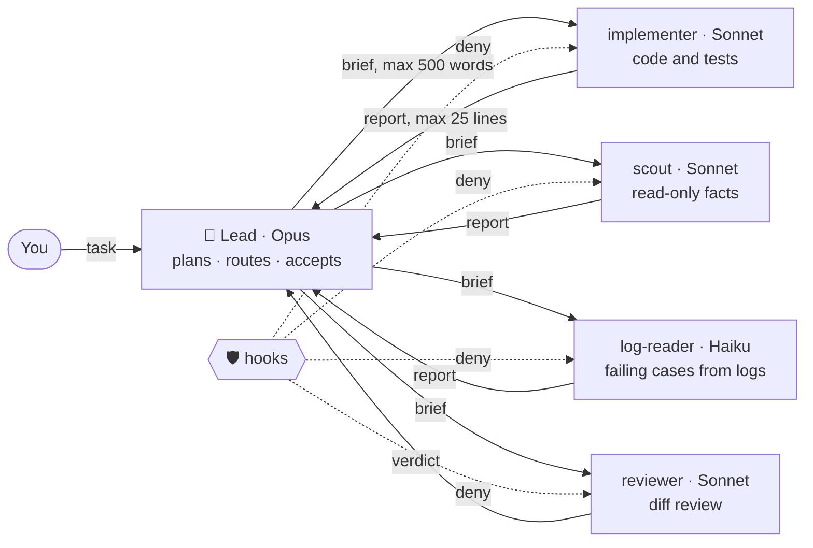

<div align="center">

# 🎼 ghorc

### Stop paying Opus prices for `cat`, `grep` and `npm test`.

**Multi-agent orchestration for Claude Code.** An Opus lead plans, cheaper Sonnet and Haiku subagents do the reading,
and hooks **enforce** the rules instead of hoping the model remembers them.

[![CI][ci-badge]][ci]
[![Version][version-badge]](CHANGELOG.md)
[![Claude Code plugin][cc-badge]](#-quick-start-60-seconds)
[![License: MIT][mit-badge]](LICENSE)
[![Node >=20][node-badge]](package.json)
[![Dependencies: 0][deps-badge]](package.json)
[![Linux | Windows][os-badge]][ci]
[![PRs welcome][pr-badge]](CONTRIBUTING.md)
[![GitHub stars][stars-badge]][stars]

[**Quick start**](#-quick-start-60-seconds) ·
[**See it in action**](#-see-it-in-action) ·
[**How it works**](#-how-it-works) ·
[**vs plain Claude Code**](#-ghorc-vs-plain-claude-code) ·
[**FAQ**](#-faq) ·
[**Docs**](#-docs)

</div>

[ci]: https://github.com/gagharutyunyan1993/ghorc/actions/workflows/test.yml
[ci-badge]: https://github.com/gagharutyunyan1993/ghorc/actions/workflows/test.yml/badge.svg
[version-badge]: https://img.shields.io/github/package-json/v/gagharutyunyan1993/ghorc?label=version&color=orange
[cc-badge]: https://img.shields.io/badge/Claude%20Code-plugin-D97757
[mit-badge]: https://img.shields.io/badge/license-MIT-blue.svg
[node-badge]: https://img.shields.io/badge/node-%3E%3D20-brightgreen.svg
[deps-badge]: https://img.shields.io/badge/dependencies-0-brightgreen.svg
[os-badge]: https://img.shields.io/badge/tested%20on-Linux%20%7C%20Windows-informational
[pr-badge]: https://img.shields.io/badge/PRs-welcome-brightgreen.svg
[stars-badge]: https://img.shields.io/github/stars/gagharutyunyan1993/ghorc?style=social
[stars]: https://github.com/gagharutyunyan1993/ghorc/stargazers

---

## 😩 Sound familiar?

You give Claude Code a real task on a real project. An hour later:

- 🔥 **The context window is full** of logs, test output and whole files the lead only needed three lines of. Then
  auto-compaction kicks in and half the plan is gone.
- 💸 **Your most expensive model is grepping.** Opus spends turn after turn reading and searching, work Sonnet
  or Haiku could do.
- 🔁 **A subagent reads the same file for the fifth time** without changing a line.
- 🐢 **Workers launch the full test suite on their own**, sometimes several at once.

Prompts and `CLAUDE.md` rules ask the model to behave. **ghorc makes it behave:** the tool call is denied by a hook
before it runs.

## ✨ What you get

| | Feature | What it does |
|---|---|---|
| 🧭 | **Lead / worker split** | An Opus lead plans and accepts; Sonnet and Haiku subagents code, scout and review. |
| 🎯 | **Model routing by role** | Each role has its own model and effort ([why each one](docs/models.md)). |
| 🛡️ | **read-guard** | The 4th read of a file with no edit in between is denied. |
| 🧪 | **heavy-check-guard** | Only the lead runs heavy commands (`npm run test:full`, e2e, builds). |
| 🤖 | **agent-guard** | No untyped `general-purpose` agents or `fork`s that run at Opus rates. |
| 🔄 | **Handoff, not compaction** | `/ghorc:handoff` passes the lead shift to a fresh session via `STATE.md`. |
| 📊 | **Status line** | Model, effort, context %, 5h and 7d usage, role, branch, at a glance. |
| 📒 | **Call ledger** | One line per subagent call: role, model, tokens, duration. Never the prompt. |
| 🔒 | **Opt-in guards** | `git-guard` (no `--no-verify` and friends), `ci-retry-guard`, `capacity-guard`. |
| 🪶 | **Light and safe** | Zero dependencies, no network calls, opt-in per project, fails open on internal errors. |

## 🚀 Quick start (60 seconds)

Requirements: Claude Code with plugin support, Node.js 20+ on `PATH`, git.

```bash
claude plugin marketplace add gagharutyunyan1993/ghorc
claude plugin install ghorc@ghorc
```

Then, inside your project, in Claude Code:

```
/ghorc:setup     # checks and applies the recommended setup, only what you confirm
/ghorc:lead      # this session becomes the lead
```

That's it. Give the lead a task and watch it delegate.

> **Just want to look?** Run one session without installing: `claude --plugin-dir <path-to-clone>`.

<details>
<summary><b>Install details</b>: dependency, permission modes, per-project opt-in, upgrading</summary>

<br>

The install also brings [methodology-toolkit](https://github.com/gagharutyunyan1993/methodology-toolkit) (the critic,
evidence scout and decision methods the lead uses), as a dependency from the same marketplace. If you already have it
from its own marketplace, keep one copy: two copies of one plugin load, but only one runs its hooks.

`/ghorc:setup` asks you how tab workers and candidate leads start: `bypass` (no permission prompts; ghorc's hooks still
deny), `acceptEdits` or `prompts` (the default until you choose; an unattended tab then stops on each prompt). The
answer goes to `worker.permissionArgs` and `handoff.candidatePermissionArgs`
([configuration](docs/configuration.md#worker)). It also asks who closes the old lead's tab after a handoff, the new
lead or you (the default); the answer goes to `handoff.allowSendKeysExit`.

ghorc installs for all projects but does nothing in a project until it has `.claude/ghorc.json`: no hook denies or
reminds there, and the status line writes no files into it. `/ghorc:setup` creates that file. It checks the status
line, the autocompact threshold, `.claude/ghorc.json`, the `CLAUDE.md` section and the git exclude, proposes
`heavyCommands` from your `package.json` scripts, and applies only the items you confirm.

Upgrading from 0.4.x: see [CHANGELOG.md](CHANGELOG.md) (the marketplace was renamed from `ghorc-local` to `ghorc`).

</details>

## 🎬 See it in action

<!-- Tip: replace this block with a GIF (docs/demo.gif) recorded with vhs or asciinema; keep the text below it. -->

Real hook output from [examples/demo](examples/demo/README.md) (a worker is a subagent; deny reasons are shown
without their JSON wrapper):

```
# SessionStart in a plain `claude` session
ghorc 0.11.2 session=a1b2c3d4-0000-4000-8000-000000000001 role=lead
config: ok
lead: load skill ghorc:lead
# read-guard: the worker reads src/slugify.js a 4th time without editing it
deny: slugify.js was already read 3 times: do not re-read it, use what you have or edit it first.
# heavy-check-guard: the worker runs `npm run test:full` (the same command from the lead is allowed)
deny: only the lead runs heavy checks.
# setup.cjs --check --status, which /ghorc:status runs
status: read-guard on (maxRepeat=3, media blocked for the lead: no), heavy-check-guard on (2 patterns)
status: denials 2 total (read-guard=1, heavy-check-guard=1), last 2:
```

## 🧠 How it works



1. **The lead writes a brief**: 7 tags, at most 500 words ([`/ghorc:brief`](skills/brief/SKILL.md) has templates).
2. **A worker does the heavy reading** on a cheaper model and writes a short report; details go to a file, not into
   the lead's context.
3. **Hooks keep workers honest**: no endless re-reads, no full test suite, no starting more agents.
4. **The lead checks the diff** and runs the full check once, in the background.
5. **Context getting full?** `/ghorc:handoff` hands the shift to a fresh lead instead of a lossy auto-compaction.

Full cycle: [docs/workflow.md](docs/workflow.md).

## 🆚 ghorc vs plain Claude Code

| | Plain Claude Code | **Claude Code + ghorc** |
|---|---|---|
| Who reads big files and logs | Usually the main session | Sonnet / Haiku workers, by role |
| Which model does what | Whatever each call says | A role table: model and effort per class of work |
| Rules for subagents | Advice in prompts and `CLAUDE.md` | Advice **plus hooks that deny the tool call** |
| Same file read again and again | Allowed | 4th read without an edit is denied |
| Full test suite from a subagent | Allowed | Denied; only the lead runs heavy checks |
| Context window fills up | Auto-compaction | Planned handoff to a fresh lead via `STATE.md` |
| What happened | Read the transcript | Status line, denial log, per-call ledger |

## 🛡️ Enforced vs advised

| Enforced by hooks (the tool call is denied) | Advised (skills, roles, `CLAUDE.md`) |
|---|---|
| A 4th read of a file with no edit in between (`readGuard.maxRepeat`) | Which role, model and effort gets which work |
| A subagent or `GHORC_ROLE=worker` running a `heavyCommands` match | Briefs: 7 tags, at most 500 words |
| A subagent starting agents or sending prompts (list below) | Reports: at most 25 lines, the rest to a file |
| A PDF without `pages`; media outside the `media` role; media budgets | Context thresholds: 120K, 150K |
| Any heavy command while `.claude/ghorc.json` is invalid | The lead runs the full check once, in the background |

Denied for subagents: `claude -p`, `herdr agent start|prompt|send-keys`, `herdr pane run|send-keys|send-text`,
`hc run|exec|keys|interrupt` (and `hc send`, except a worker to its own parent).

Details: [docs/hooks.md](docs/hooks.md) and [docs/workflow.md](docs/workflow.md).

## ⌨️ Commands

| Command | What it does |
|---|---|
| `/ghorc:setup` | checks the recommended setup, shows a table, applies only confirmed items |
| `/ghorc:lead` | loads the lead rules: routing, effort, thresholds, acceptance (`/ghorc:orc` is a 0.5 alias) |
| `/ghorc:status` | one block: role, active guards, heavy patterns, watchdog, context, recent denials |
| `/ghorc:brief` | the brief structure (7 tags) and three templates |
| `/ghorc:handoff` | hands the lead shift to a fresh session via `STATE.md`; with `hc` or `herdr`, into a new tab |

## 👥 Roles

Called as `ghorc:<role>`. The lead passes model and effort on every call and names the move-up condition when it
raises one. The starting choices follow Anthropic's model guide and are explained row by row in
[docs/models.md](docs/models.md); a row changes only when the ledger measures a reason to (see
[docs/evidence.md](docs/evidence.md)). The lead itself is Opus/medium, or Fable/medium for a major refactor or
migration, and changes model only at a handoff.

| Role | Model / effort | Purpose |
|---|---|---|
| `implementer` | sonnet / medium (opus for migrations and performance work) | code, tests and documents from a brief |
| `reviewer` | sonnet / medium | ordinary diff review; writes a review file with a verdict |
| `scout` | sonnet / medium | read-only facts with `file:line`, written to a file |
| `log-reader` | haiku / medium | failing cases from test output and logs, written to a file |
| `reviewer-critical` (advanced) | opus / high (fable on Opus work) | adversarial review of `criticalPaths` |
| `media` (advanced) | sonnet / medium | the only subagent role that reads PDFs and images |
| `consult` (advanced) | sonnet / low | asks external models in a browser (needs a browser MCP) |

`integrator` and `release` also ship; see [docs/workflow.md](docs/workflow.md).

## 📊 Status line

Added by `/ghorc:setup` (item `statusLine`):

```
model ·effort [⚡] │ ctx NN% (used/size) [→ac N%] │ 5h NN% (~Nh) │ 7d NN% (~Nh) │ role │ [⎇ ]branch │ session
```

Every segment is explained in [docs/hooks.md](docs/hooks.md#status-line).

## 🧪 Try the demo in 5 minutes

[examples/demo](examples/demo/README.md) is a dependency-free Node project with one failing test and a 3-second
stand-in for a heavy suite.

1. Install the plugin as above and clone this repository.
2. Open Claude Code in `examples/demo`. The SessionStart lines above appear (`role=lead`, `config: ok`).
3. Run `/ghorc:setup`. `heavyCommands` already lists `npm run test:full` and `node scripts/slow-check.js`.
4. Run `/ghorc:lead`: this session becomes the lead.
5. Tell the lead: `The slugify test fails; fix it.`
6. The lead writes a brief like [briefs/fix-slugify.md](examples/demo/briefs/fix-slugify.md) and starts
   `ghorc:implementer`, which runs `npm test`, edits `src/slugify.js` and writes a short report.
7. If the worker re-reads a file a 4th time or tries `npm run test:full`, the hook denies it, as above.
8. The lead checks the diff, runs `npm run test:full` once in the background, and `/ghorc:status` shows the denials.

Compare the worker's report with [expected-report.md](examples/demo/expected-report.md). Reset with
`git checkout -- src`.

## 📏 No fake benchmarks

ghorc does not promise "70% fewer tokens". **No numbers are published yet**, and the README will not claim savings
until they are measured. [docs/evidence.md](docs/evidence.md) describes how to measure lead compactions, denied worker
runs and estimated cost against plain Claude Code on the same tasks. Ran it on your project? Share the numbers in an
issue.

Known limits:

- **The hooks are not a sandbox.** They match tool calls against rules; a worker can still do expensive work the rules
  do not name. `heavyCommands` is empty by default, and then the heavy guard denies nothing.
- **The heavy guard is not a scheduler.** It does not queue or limit parallel runs; it only denies matched commands to
  subagents and workers.
- **Fail-open.** On an internal error the hooks let the call proceed. The one exception: an invalid
  `.claude/ghorc.json` makes the heavy guard deny heavy commands for everyone until the file is fixed.

## ❓ FAQ

<details>
<summary><b>How do I reduce Claude Code token usage and cost on long sessions?</b></summary>

<br>

Keep the expensive model out of bulk reading. With ghorc the Opus lead delegates reading, searching, log triage and
review to Sonnet and Haiku subagents, gets short reports back, and hooks stop workers from re-reading files and
running the full suite. How much that saves on your project is measurable with [docs/evidence.md](docs/evidence.md).
</details>

<details>
<summary><b>Claude Code already has subagents. Why do I need this?</b></summary>

<br>

Subagents are the building block. ghorc adds the parts around them: a fixed role table with model and effort per
role, a brief and report format, hooks that enforce the rules, a status line, a call ledger, and a handoff to a fresh
lead when the context fills up.
</details>

<details>
<summary><b>Will it change how my other projects behave?</b></summary>

<br>

No. ghorc does nothing in a project until `/ghorc:setup` creates `.claude/ghorc.json` there.
</details>

<details>
<summary><b>Does it send my code anywhere?</b></summary>

<br>

No. The hooks make no network calls and send nothing anywhere; your model provider still receives your prompts as
usual. State lives in `<os tmp>/ghorc-<user>`; nothing is written into the project but `.claude/ghorc-out/`. Details:
[SECURITY.md](SECURITY.md).
</details>

<details>
<summary><b>Do I need herdr or hc?</b></summary>

<br>

No. Everything except a handoff into a new tab works through the Agent tool. With a terminal backend you also get
workers in their own tabs and processes: [docs/with-herdr.md](docs/with-herdr.md).
</details>

<details>
<summary><b>Does it work on Windows?</b></summary>

<br>

CI runs the test suite on Ubuntu and Windows with Node 20 and 22.
</details>

<details>
<summary><b>How do I turn on the watchdog, or remove ghorc?</b></summary>

<br>

The transcript watchdog is off by default. Turn it on with `/ghorc:setup` (item `watchdog`); stop it with
`node "<plugin>/scripts/watchdog.cjs" --stop` in the project directory.

To remove ghorc (stop the watchdog first if you turned it on, and drop `statusLine` from `~/.claude/settings.json` if
setup added it):

```bash
node "<plugin>/scripts/watchdog.cjs" --stop
claude plugin uninstall ghorc@ghorc
claude plugin marketplace remove ghorc
```
</details>

## 📚 Docs

| Page | What's inside |
|---|---|
| [workflow.md](docs/workflow.md) | the lead/worker cycle, roles, briefs, reports and acceptance |
| [models.md](docs/models.md) | which model and effort each role and class of work gets, and why |
| [hooks.md](docs/hooks.md) | each hook, the status line, the watchdog and the scripts |
| [configuration.md](docs/configuration.md) | every key of `.claude/ghorc.json` |
| [handoff.md](docs/handoff.md) | handing the lead shift to a fresh session |
| [with-herdr.md](docs/with-herdr.md) | optional terminal integration (`hc` and `herdr` backends) |
| [troubleshooting.md](docs/troubleshooting.md) | denials, status line, watchdog, updating |
| [evidence.md](docs/evidence.md) | what to measure and how |

Also: [CHANGELOG.md](CHANGELOG.md), [CONTRIBUTING.md](CONTRIBUTING.md), [SECURITY.md](SECURITY.md).

## 🤝 Contributing

Bug reports, measurements and PRs are welcome; start with [CONTRIBUTING.md](CONTRIBUTING.md).

**If ghorc kept your context window clean, give it a ⭐.** It is the easiest way to help other Claude Code users
find it.

## 📈 Star history

[![Star History Chart][star-chart]][star-page]

[star-chart]: https://api.star-history.com/svg?repos=gagharutyunyan1993/ghorc&type=Date
[star-page]: https://star-history.com/#gagharutyunyan1993/ghorc&Date

## License

MIT, see [LICENSE](LICENSE).
